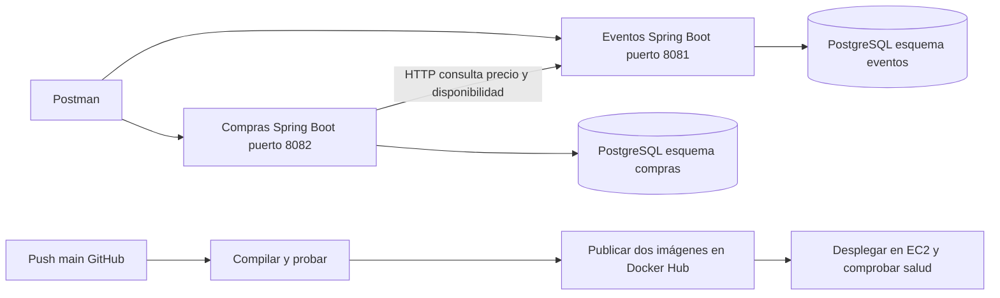

# Arquitectura y funcionamiento

El cliente utiliza Postman para consultar el catálogo y comprar entradas. Ambos servicios se ejecutan como contenedores independientes en una instancia EC2. Las imágenes se almacenan en Docker Hub. PostgreSQL 17 en EC2 contiene dos esquemas separados. Oracle XE se conserva como alternativa local.

## Flujo de compra

1. Se validan eventoId positivo y cantidad entera entre 1 y 1000.
2. Compras consulta el evento con conexión limitada a 3 segundos y lectura a 5 segundos.
3. Eventos devuelve el registro si existe y está activo. Compras comprueba que su fecha sea futura.
4. Compras multiplica el precio unitario por la cantidad usando BigDecimal.
5. Una transacción del repositorio guarda eventoId, nombre, cantidad, precio unitario, total y fecha.
6. Se responde HTTP 201 con Location y el resumen. GET permite recuperar el registro.

La base de compras conserva eventoId como referencia externa, sin clave foránea entre esquemas. El servicio de compras no accede a las tablas de eventos. La baja de un evento no elimina ventas históricas.

## Modelo persistente

| Esquema y tabla | Atributos |
| --- | --- |
| eventos.eventos | ID, NOMBRE, FECHA, PRECIO, ACTIVO |
| compras.compras | ID, EVENTO_ID, EVENTO, CANTIDAD, PRECIO_UNITARIO, PRECIO_TOTAL, FECHA_COMPRA |

Oracle usa secuencias para generar los ID. Las fechas incluyen zona horaria. El perfil oracle valida el esquema al arrancar; no crea ni destruye tablas automáticamente. Los SQL de database se ejecutan una sola vez antes del primer despliegue.

## Respuestas de error

| Situación | HTTP |
| --- | --- |
| Nombre vacío, fecha pasada, precio inválido, cantidad fuera de rango o JSON inválido | 400 |
| Evento o compra inexistente, o evento dado de baja | 404 |
| Evento vencido o inactivo recibido desde el catálogo | 409 |
| Respuesta incompleta del catálogo | 502 |
| Catálogo no disponible o respuesta HTTP remota fallida | 503 |

Los errores de validación incluyen un objeto errors con los campos rechazados. No se devuelve un stack trace ni datos de conexión. Los endpoints de salud muestran solo el estado; info muestra APP_VERSION para relacionar el contenedor con el commit.

## CI/CD

Las pull requests ejecutan pruebas sin publicar ni desplegar. Un push a main pasa por pruebas, dos construcciones de imágenes y despliegue. Cada imagen usa el SHA del commit como etiqueta. No se usa latest.

El runner agrega temporalmente su propia IP /32 al puerto SSH del grupo de seguridad y procura revocarla al finalizar. Si se cancela forzosamente el runner o se pierde conectividad con AWS, revisar y retirar manualmente la regla. La identidad del servidor se comprueba mediante known_hosts fijado previamente. La instancia conserva su .env y su wallet fuera del repositorio.

El script despliega ambos contenedores y comprueba salud e info durante hasta 180 segundos. Si falla, solicita restaurar las imágenes anteriores cuando existe una versión previa. La reversión no modifica esquemas ni datos y debe comprobarse en un ensayo real antes de presentarla como validada.

El despliegue actual usa compose.postgres.yml y perfil postgres. Sus esquemas se inicializan automaticamente en un volumen vacio; los SQL Oracle de database corresponden a la alternativa local. La configuracion .env y las contrasenas de PostgreSQL se generaron solo en el servidor.
